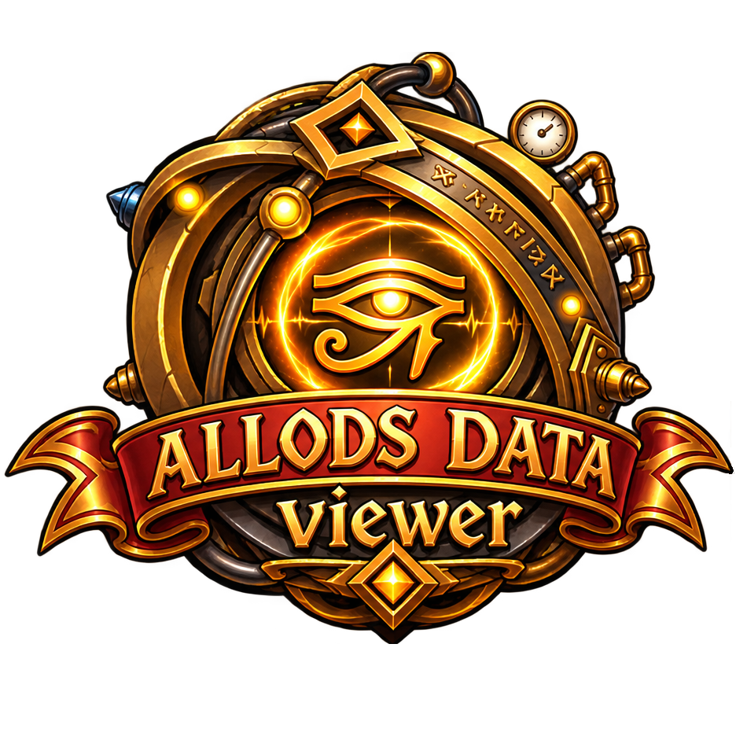

<p align="center"></p>

# Allods Data Viewer

Open source viewer, extractor and converter for the resources of the Allods Online game client:
archives, localization, textures, audio, video and models.

> Status: version 0.1.74, early development. Milestones M0 to M2 and M5 (desktop app) are done; audio, video, resource databases, models, the 3D viewer and animations are partial; materials, packing and map viewing are not started. Several format decoders (model geometry, skeletal animation, maps, materials) are `draft`: what each format reads and how far it is verified is listed in [docs/formats/README.md](docs/formats/README.md). Plan and per-milestone status: [docs/ROADMAP.md](docs/ROADMAP.md).
> Русская версия: [README.ru.md](README.ru.md).

## Goals

- Read the game's archives and resources without modifying them.
- Command line tool for listing, searching and extracting files.
- Convert textures to PNG and models to glTF.
- Desktop app (Tauri) with a file tree and a 3D preview, the same UI also runs in a browser.
- Work on Windows and Linux.

## Layout

| Path | What it is |
|---|---|
| `crates/core` | Rust library with the format readers, no UI |
| `crates/cli` | the `adv` command line tool |
| `web/` | TypeScript UI (Vite), later wrapped by Tauri |
| `docs/` | roadmap, architecture, format notes |

## Install and build (Windows and Linux)

Windows steps come first; the **Linux** section follows right after.

This guide takes you from "I downloaded the source code" to "the app window is running". No Git and no programming experience are required. Everything is done in **PowerShell**.

### What you need

| Tool | Why | Version |
|---|---|---|
| Rust | compiles the application | 1.100 (installed automatically by the project) |
| Microsoft C++ Build Tools (MSVC) | linker and compiler Rust needs on Windows | any current version |
| Node.js | builds the web interface | **26 or newer** |
| WebView2 Runtime | draws the app window | normally already in Windows 10/11 |

Git is **not** needed.

### Step 1. Unpack the source code

1. Download the source archive (`allods-data-viewer-<version>.zip`).
2. Right-click the zip → **Extract All…** and pick a folder with a short path without special characters, for example `%USERPROFILE%\Downloads\BUILDS`.
3. You should get a folder like `$env:USERPROFILE\Downloads\BUILDS\allods-data-viewer-<version>` containing `Cargo.toml`, `web`, `crates`, `scripts`.

Below, this folder is called **the project folder**.

### Step 2. Install Microsoft C++ Build Tools (MSVC)

Rust on Windows needs Microsoft's linker. Install it **first**.

1. Open <https://visualstudio.microsoft.com/downloads/> and scroll to **All Downloads → Tools for Visual Studio**.
2. Download **Build Tools for Visual Studio** (the latest version) and run the installer.
3. In the installer tick the workload **Desktop development with C++** and click **Install**. Defaults are fine.
4. Wait until it finishes (it is a large download). A restart is requested only if the installer says so.

If you already have Visual Studio with the "Desktop development with C++" workload, skip this step.

### Step 3. Install Rust

1. Open <https://rustup.rs> and download **rustup-init.exe** (64-bit).
2. Run it and choose **1) Proceed with standard installation**.
3. Close the window when it says Rust is installed.

You do not need to pick a Rust version: the file `rust-toolchain.toml` in the project pins 1.100, and rustup downloads it automatically on the first build.

### Step 4. Install Node.js

1. Open <https://nodejs.org> and download the **LTS** installer for Windows (it must be **26.x** or newer; if the site offers an older LTS, use the "Current" download or the "Previous Releases" page and pick 26.x or newer).
2. Run the installer with default options (keep "Add to PATH" enabled).

### Step 5. Check the installation

Close all PowerShell windows and open a **new** one (this refreshes PATH), then run:

```powershell
rustup --version
cargo --version
node --version
npm --version
```

Expected: all four commands print a version, and `node --version` shows `v26.` or higher.

Optional, one-command alternative to steps 3–4 (Windows 10/11 with winget):

```powershell
winget install Rustlang.Rustup
winget install OpenJS.NodeJS.LTS
```

Then re-check versions as above. MSVC (step 2) still needs to be installed separately.

### Step 6. Build and run

Open PowerShell in the project folder (in Explorer: open the folder, click the address bar, type `powershell`, press Enter), or:

```powershell
cd $env:USERPROFILE\Downloads\BUILDS\allods-data-viewer-<version>
```

#### Option A — one script

```powershell
.\scripts\run-app.ps1
```

The script installs web dependencies, builds the web interface and starts the app window. The first run takes several minutes because Rust downloads and compiles dependencies.

If Windows says scripts are disabled:

```powershell
powershell -ExecutionPolicy Bypass -File .\scripts\run-app.ps1
```

or allow local scripts once: `Set-ExecutionPolicy -Scope CurrentUser RemoteSigned`.
If the files came from a downloaded zip and are blocked: `Get-ChildItem -Recurse .\scripts | Unblock-File`.

#### Option B — manual commands

```powershell
cd web
npm ci
npm run build
cd ..
cargo run --release -p adv-desktop
```

To build without launching:

```powershell
cargo build --release -p adv-desktop
```

The result is `target\release\allods-data-viewer.exe`. The web interface is embedded in it, so the file can be launched directly.

### Step 7. Use the app

Enter the path to your game data folder (for example `C:\AstrumPlay\Аллоды Онлайн\data`) or drag a folder or a `.pak` file into the window, then click **Open**.

### Optional: run the project checks

```powershell
.\scripts\check-all.ps1
```

### Troubleshooting

| Problem | Solution |
|---|---|
| `link.exe not found` | MSVC Build Tools are missing — do Step 2 and open a new PowerShell |
| `cargo` or `node` is not recognized | Open a **new** PowerShell window; if it persists, reinstall the tool |
| `npm ci` complains about Node version | Install Node.js 26 or newer (Step 4) |
| `rustc 1.9x is not supported` | Run `rustup update`, then retry inside the project folder |
| Script cannot be run | See "If Windows says scripts are disabled" in Step 6 |
| Blank window or WebView error | Install/repair Microsoft Edge WebView2 Runtime from <https://developer.microsoft.com/microsoft-edge/webview2/> |
| Build is very slow the first time | Normal: dependencies are compiled once, later builds are fast |

## Install on Linux

Same project, same result. The Linux script is `scripts/run-app.sh`. The window needs a desktop session (X11 or Wayland); it will not open on a headless server.

### L1. Unpack the source code

```bash
unzip allods-data-viewer-<version>.zip -d ~/dev
cd ~/dev/allods-data-viewer-<version>
```

(or use your file manager: right-click → Extract). If `unzip` is missing, install it with your package manager.

### L2. Install system packages (compiler and WebKitGTK)

The app window uses Tauri 2, which needs **WebKitGTK 4.1** development files and a C toolchain.

**Debian / Ubuntu / Mint:**

```bash
sudo apt update
sudo apt install -y build-essential pkg-config curl wget file unzip \
  libwebkit2gtk-4.1-dev libssl-dev libxdo-dev \
  libayatana-appindicator3-dev librsvg2-dev
```

**Fedora:**

```bash
sudo dnf install -y @development-tools pkgconf-pkg-config curl wget file unzip \
  webkit2gtk4.1-devel openssl-devel libxdo-devel \
  libappindicator-gtk3-devel librsvg2-devel
```

**Arch / Manjaro:**

```bash
sudo pacman -Syu --needed base-devel curl wget file unzip \
  webkit2gtk-4.1 openssl xdotool libappindicator-gtk3 librsvg
```

Other distributions: install the equivalents of the packages above (`webkit2gtk-4.1` dev package, OpenSSL dev package, a C compiler, `pkg-config`). If the Rust build later complains about a missing `.pc` file, install the dev package it names.

### L3. Install Rust

```bash
curl --proto '=https' --tlsv1.2 -sSf https://sh.rustup.rs | sh
```

Choose **1) Proceed with standard installation**, then load Rust into the current shell:

```bash
. "$HOME/.cargo/env"
```

The project pins Rust 1.100 in `rust-toolchain.toml`; rustup downloads it automatically on the first build.

### L4. Install Node.js 26 or newer

Use one of these:

**Option 1 — nvm (reads the version from the project's `.nvmrc`):**

```bash
curl -o- https://raw.githubusercontent.com/nvm-sh/nvm/master/install.sh | bash
# open a new terminal, then, in the project folder:
nvm install
nvm use
```

**Option 2 — official downloads:** get the Linux build (**26.x or newer**) from <https://nodejs.org> and follow the instructions there, or use your distribution's package if it provides Node 26+.

### L5. Check the installation

```bash
rustup --version
cargo --version
node --version    # must be v26 or higher
npm --version
pkg-config --modversion webkit2gtk-4.1
```

All commands must print a version. If `cargo` is not found, run `. "$HOME/.cargo/env"` or open a new terminal.

### L6. Build and run

In the project folder:

#### Option A — one script

```bash
bash ./scripts/run-app.sh
```

(If you prefer `./scripts/run-app.sh`, make it executable once: `chmod +x scripts/*.sh`. Zip archives often lose the executable bit.)

The script runs `npm ci`, builds the web interface and starts the window with `cargo run --release -p adv-desktop`. The first run takes several minutes.

#### Option B — manual commands

```bash
cd web
npm ci
npm run build
cd ..
cargo run --release -p adv-desktop
```

To build without launching:

```bash
cargo build --release -p adv-desktop
```

The result is `target/release/allods-data-viewer`. The web interface is embedded in it. Note that it still needs the WebKitGTK 4.1 runtime library on the machine where it runs.

### L7. Optional: project checks

```bash
bash ./scripts/check-all.sh
```

### Linux troubleshooting

| Problem | Solution |
|---|---|
| `The system library webkit2gtk-4.1 ... was not found` or a missing `.pc` file | Install the WebKitGTK 4.1 dev package from L2 (not the older 4.0 one) |
| `linker cc not found` | Install the C toolchain (`build-essential` / `@development-tools` / `base-devel`) |
| `cargo` not found | Run `. "$HOME/.cargo/env"` or open a new terminal |
| `npm ci` complains about Node version | Install Node.js 26+ (L4); check with `node --version` |
| `Permission denied` on the script | Run it as `bash ./scripts/run-app.sh` or `chmod +x scripts/*.sh` |
| Window does not open / no display | A graphical session is required; over SSH use a desktop session or X forwarding |

## Develop and test

Requirements: [Rust](https://rustup.rs) (stable, 1.100 or newer) and [Node.js](https://nodejs.org) 26 or newer (LTS).
On Windows Rust also needs the Microsoft C++ Build Tools.

```
cargo test --workspace
cargo run -p adv-cli

cd web
npm install
npm test
npm run build
```

## Contributors

See [CONTRIBUTORS.md](CONTRIBUTORS.md). Contributions are welcome, see [CONTRIBUTING.md](CONTRIBUTING.md).

## Legal

Allods Data Viewer is an independent project. It is not affiliated with the game's developers
or publishers. The repository contains no game assets and never will, test data is
generated in the tests. Game and company names belong to their respective owners.

The file format notes come from our own analysis of samples and from the projects listed in
[docs/REFERENCES.md](docs/REFERENCES.md). No code is copied from projects whose license forbids it, see
[CONTRIBUTING.md](CONTRIBUTING.md). "Allods Online" is a trademark of its owners; the name is used only to say which game the tool works with.

Licensed under the [MIT License](LICENSE).
