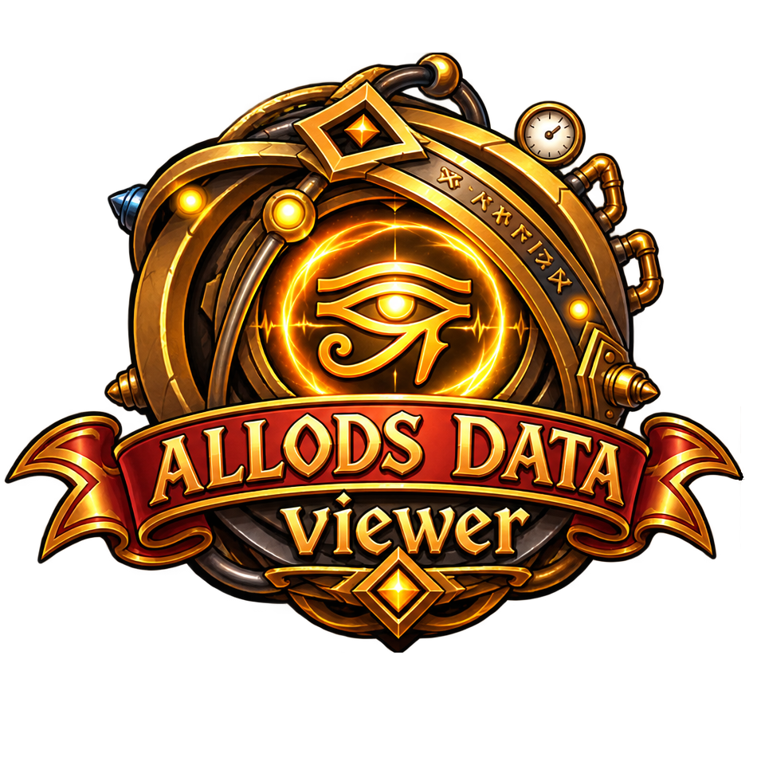

<p align="center"></p>

# Allods Data Viewer

Open source viewer, extractor and converter for the resources of the Allods Online game client:
archives, localization, textures, audio, video and models.

> Status: **M0**, project skeleton. See [docs/ROADMAP.md](docs/ROADMAP.md).
> Русская версия: [README.ru.md](README.ru.md).

## Goals

- Read the game's archives and resources without modifying them.
- Command line tool for listing, searching and extracting files.
- Convert textures to PNG and models to glTF.
- Desktop app (Tauri) with a file tree and a 3D preview, the same UI also runs in a browser.
- Work on Windows and Linux.

## Layout

| Path | What it is |
|---|---|
| `crates/core` | Rust library with the format readers, no UI |
| `crates/cli` | the `adv` command line tool |
| `web/` | TypeScript UI (Vite), later wrapped by Tauri |
| `docs/` | roadmap, architecture, format notes |

## Build and test

Requirements: [Rust](https://rustup.rs) (stable, 1.99 or newer) and [Node.js](https://nodejs.org) 26 or newer (LTS).
On Windows Rust also needs the Microsoft C++ Build Tools.

```
cargo test --workspace
cargo run -p adv-cli

cd web
npm install
npm test
npm run build
```

## Legal

Allods Data Viewer is an independent project. It is not affiliated with the game's developers
or publishers. The repository contains no game assets and never will, test data is
generated in the tests. Game and company names belong to their respective owners.

The file format notes come from our own analysis of samples and from the projects listed in
[docs/REFERENCES.md](docs/REFERENCES.md). No code is copied from projects whose license forbids it, see
[CONTRIBUTING.md](CONTRIBUTING.md). "Allods Online" is a trademark of its owners; the name is used only to say which game the tool works with.

Licensed under the [MIT License](LICENSE).
