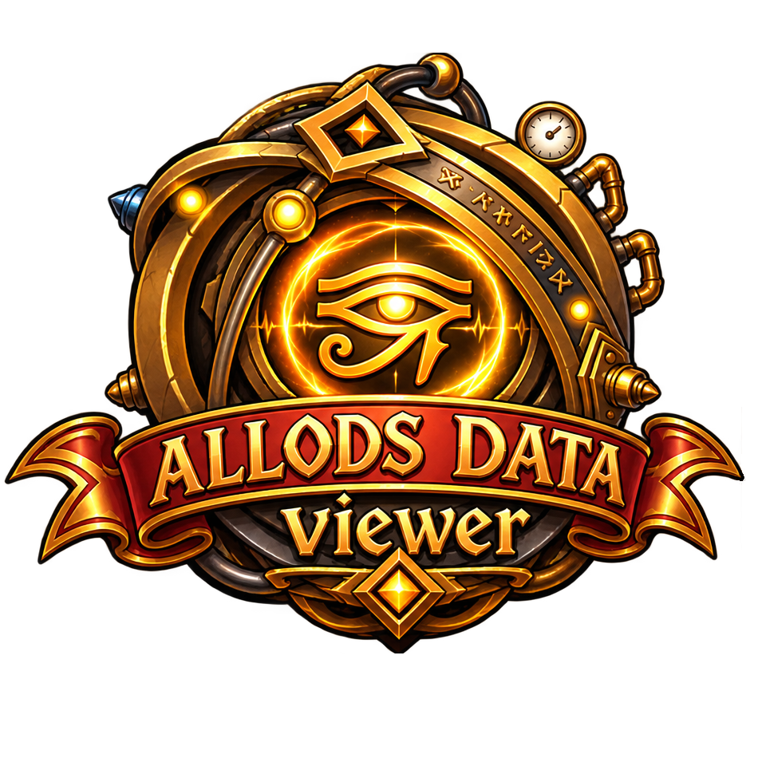

<p align="center"></p>

# Allods Data Viewer

Открытый просмотрщик, распаковщик и конвертер ресурсов клиента игры Allods Online:
архивы, локализация, текстуры, звук, видео и модели.

> Статус: **M0**, скелет проекта. План работ: [docs/ROADMAP.md](docs/ROADMAP.md).

## Цели

- Читать архивы и ресурсы игры, ничего в них не меняя.
- Консольная утилита: список файлов, поиск, распаковка.
- Текстуры в PNG, модели в glTF.
- Настольное приложение (Tauri) с деревом файлов и 3D-просмотром, тот же интерфейс работает в браузере.
- Windows и Linux.

## Устройство

| Путь | Что это |
|---|---|
| `crates/core` | библиотека на Rust с разбором форматов, без интерфейса |
| `crates/cli` | консольная утилита `adv` |
| `web/` | интерфейс на TypeScript (Vite), позже обернём в Tauri |
| `docs/` | план, архитектура, описание форматов |

## Установка и сборка (Windows и Linux)

Сначала шаги для Windows, раздел **Linux** идёт следом.

Руководство ведёт от «я скачал исходники» до «окно приложения запущено». Git и опыт программирования не нужны. Все команды выполняются в **PowerShell**.

### Что понадобится

| Инструмент | Зачем | Версия |
|---|---|---|
| Rust | компилирует приложение | 1.99 (проект ставит нужную версию сам) |
| Microsoft C++ Build Tools (MSVC) | компилятор и компоновщик, которые Rust требует на Windows | любая актуальная |
| Node.js | собирает веб-интерфейс | **26 или новее** |
| WebView2 Runtime | рисует окно приложения | обычно уже есть в Windows 10/11 |

Git **не нужен**.

### Шаг 1. Распаковать исходники

1. Скачайте архив с исходниками (`allods-data-viewer-<версия>.zip`).
2. Правый клик по zip → **Извлечь все…** и выберите папку с коротким путём без спецсимволов, например `%USERPROFILE%\Downloads\BUILDS`.
3. Должна получиться папка вроде `$env:USERPROFILE\Downloads\BUILDS\allods-data-viewer-<version>`, внутри которой лежат `Cargo.toml`, `web`, `crates`, `scripts`.

Дальше эта папка называется **папкой проекта**.

### Шаг 2. Установить Microsoft C++ Build Tools (MSVC)

Rust в Windows нужен компоновщик от Microsoft. Ставьте его **первым**.

1. Откройте <https://visualstudio.microsoft.com/downloads/> и прокрутите до **Все загрузки → Инструменты для Visual Studio**.
2. Скачайте **Build Tools for Visual Studio** (последнюю версию) и запустите установщик.
3. В установщике отметьте рабочую нагрузку **Разработка классических приложений на C++** (Desktop development with C++) и нажмите **Установить**. Параметры по умолчанию подходят.
4. Дождитесь окончания (загрузка большая). Перезагрузка нужна, только если установщик об этом скажет.

Если у вас уже стоит Visual Studio с этой нагрузкой, шаг можно пропустить.

### Шаг 3. Установить Rust

1. Откройте <https://rustup.rs> и скачайте **rustup-init.exe** (64-bit).
2. Запустите его и выберите **1) Proceed with standard installation**.
3. Когда появится сообщение, что Rust установлен, закройте окно.

Выбирать версию Rust не нужно: файл `rust-toolchain.toml` в проекте закрепляет 1.99, и rustup скачает её сам при первой сборке.

### Шаг 4. Установить Node.js

1. Откройте <https://nodejs.org> и скачайте установщик **LTS** для Windows (версия должна быть **26.x или новее**; если сайт предлагает более старую LTS, возьмите «Current» или страницу «Previous Releases» и выберите 26.x или новее).
2. Запустите установщик с параметрами по умолчанию (оставьте включённым «Add to PATH»).

### Шаг 5. Проверить установку

Закройте все окна PowerShell и откройте **новое** (так обновится PATH), затем выполните:

```powershell
rustup --version
cargo --version
node --version
npm --version
```

Ожидаемый результат: все четыре команды выводят версию, а `node --version` показывает `v26.` или выше.

Необязательная альтернатива шагам 3–4 одной командой (Windows 10/11 с winget):

```powershell
winget install Rustlang.Rustup
winget install OpenJS.NodeJS.LTS
```

После этого снова проверьте версии. MSVC (шаг 2) всё равно ставится отдельно.

### Шаг 6. Собрать и запустить

Откройте PowerShell в папке проекта (в Проводнике: откройте папку, щёлкните адресную строку, введите `powershell`, нажмите Enter) или выполните:

```powershell
cd $env:USERPROFILE\Downloads\BUILDS\allods-data-viewer-<version>
```

#### Вариант A — одним скриптом

```powershell
.\scripts\run-app.ps1
```

Скрипт ставит зависимости веб-части, собирает веб-интерфейс и запускает окно приложения. Первый запуск занимает несколько минут: Rust скачивает и компилирует зависимости.

Если Windows пишет, что запуск скриптов отключён:

```powershell
powershell -ExecutionPolicy Bypass -File .\scripts\run-app.ps1
```

или один раз разрешите локальные скрипты: `Set-ExecutionPolicy -Scope CurrentUser RemoteSigned`.
Если файлы из скачанного zip заблокированы: `Get-ChildItem -Recurse .\scripts | Unblock-File`.

#### Вариант B — вручную командами

```powershell
cd web
npm ci
npm run build
cd ..
cargo run --release -p adv-desktop
```

Чтобы только собрать, без запуска:

```powershell
cargo build --release -p adv-desktop
```

Результат: `target\release\allods-data-viewer.exe`. Веб-интерфейс встроен в него, поэтому файл можно запускать напрямую.

### Шаг 7. Работа с приложением

Введите путь к папке с данными игры (например `C:\AstrumPlay\Аллоды Онлайн\data`) или перетащите папку либо файл `.pak` в окно и нажмите **Открыть**.

### По желанию: запустить проверки проекта

```powershell
.\scripts\check-all.ps1
```

### Если что-то не так

| Проблема | Решение |
|---|---|
| `link.exe not found` | Не стоят MSVC Build Tools — выполните шаг 2 и откройте новый PowerShell |
| `cargo` или `node` не распознаётся | Откройте **новое** окно PowerShell; если не помогло, переустановите инструмент |
| `npm ci` ругается на версию Node | Установите Node.js 26 или новее (шаг 4) |
| `rustc 1.9x is not supported` | Выполните `rustup update` и повторите в папке проекта |
| Скрипт не запускается | См. «Если Windows пишет, что запуск скриптов отключён» в шаге 6 |
| Пустое окно или ошибка WebView | Установите или восстановите Microsoft Edge WebView2 Runtime: <https://developer.microsoft.com/microsoft-edge/webview2/> |
| Первая сборка очень долгая | Это нормально: зависимости компилируются один раз, дальше быстрее |

## Установка в Linux

Тот же проект, тот же результат. Скрипт для Linux: `scripts/run-app.sh`. Окну нужна графическая сессия (X11 или Wayland); на сервере без экрана оно не откроется.

### L1. Распаковать исходники

```bash
unzip allods-data-viewer-<version>.zip -d ~/dev
cd ~/dev/allods-data-viewer-<version>
```

(или файловым менеджером: правый клик → Извлечь). Если `unzip` нет, поставьте его пакетным менеджером.

### L2. Установить системные пакеты (компилятор и WebKitGTK)

Окно приложения построено на Tauri 2, которому нужны dev-файлы **WebKitGTK 4.1** и C-компилятор.

**Debian / Ubuntu / Mint:**

```bash
sudo apt update
sudo apt install -y build-essential pkg-config curl wget file unzip \
  libwebkit2gtk-4.1-dev libssl-dev libxdo-dev \
  libayatana-appindicator3-dev librsvg2-dev
```

**Fedora:**

```bash
sudo dnf install -y @development-tools pkgconf-pkg-config curl wget file unzip \
  webkit2gtk4.1-devel openssl-devel libxdo-devel \
  libappindicator-gtk3-devel librsvg2-devel
```

**Arch / Manjaro:**

```bash
sudo pacman -Syu --needed base-devel curl wget file unzip \
  webkit2gtk-4.1 openssl xdotool libappindicator-gtk3 librsvg
```

Другие дистрибутивы: поставьте аналоги этих пакетов (dev-пакет `webkit2gtk-4.1`, dev-пакет OpenSSL, C-компилятор, `pkg-config`). Если сборка Rust потом пожалуется на отсутствующий `.pc`-файл, поставьте dev-пакет, который она назвала.

### L3. Установить Rust

```bash
curl --proto '=https' --tlsv1.2 -sSf https://sh.rustup.rs | sh
```

Выберите **1) Proceed with standard installation**, затем подключите Rust в текущую оболочку:

```bash
. "$HOME/.cargo/env"
```

Версия Rust 1.99 закреплена в `rust-toolchain.toml`, rustup скачает её сам при первой сборке.

### L4. Установить Node.js 26 или новее

Любой из способов:

**Способ 1 — nvm (берёт версию из `.nvmrc` проекта):**

```bash
curl -o- https://raw.githubusercontent.com/nvm-sh/nvm/master/install.sh | bash
# откройте новый терминал и в папке проекта выполните:
nvm install
nvm use
```

**Способ 2 — официальные сборки:** скачайте Linux-версию (**26.x или новее**) с <https://nodejs.org> и следуйте инструкции там, либо возьмите пакет из репозитория дистрибутива, если в нём есть Node 26+.

### L5. Проверить установку

```bash
rustup --version
cargo --version
node --version    # должна быть v26 или выше
npm --version
pkg-config --modversion webkit2gtk-4.1
```

Все команды должны вывести версию. Если `cargo` не найден, выполните `. "$HOME/.cargo/env"` или откройте новый терминал.

### L6. Собрать и запустить

В папке проекта.

#### Вариант A — одним скриптом

```bash
bash ./scripts/run-app.sh
```

(Если хотите запускать как `./scripts/run-app.sh`, один раз сделайте файлы исполняемыми: `chmod +x scripts/*.sh`. В zip-архивах бит исполнения часто теряется.)

Скрипт выполняет `npm ci`, собирает веб-интерфейс и запускает окно командой `cargo run --release -p adv-desktop`. Первый запуск занимает несколько минут.

#### Вариант B — вручную командами

```bash
cd web
npm ci
npm run build
cd ..
cargo run --release -p adv-desktop
```

Чтобы только собрать, без запуска:

```bash
cargo build --release -p adv-desktop
```

Результат: `target/release/allods-data-viewer`. Веб-интерфейс встроен в него. Учтите, что на машине, где файл запускается, всё равно нужна библиотека WebKitGTK 4.1.

### L7. По желанию: проверки проекта

```bash
bash ./scripts/check-all.sh
```

### Если что-то не так на Linux

| Проблема | Решение |
|---|---|
| `The system library webkit2gtk-4.1 ... was not found` или нет `.pc`-файла | Поставьте dev-пакет WebKitGTK 4.1 из L2 (не старый 4.0) |
| `linker cc not found` | Поставьте C-компилятор (`build-essential` / `@development-tools` / `base-devel`) |
| `cargo` не найден | Выполните `. "$HOME/.cargo/env"` или откройте новый терминал |
| `npm ci` ругается на версию Node | Поставьте Node.js 26+ (L4), проверьте `node --version` |
| `Permission denied` при запуске скрипта | Запускайте как `bash ./scripts/run-app.sh` или `chmod +x scripts/*.sh` |
| Окно не открывается / нет дисплея | Нужна графическая сессия; по SSH используйте рабочий стол или X-forwarding |

## Разработка и тесты

Нужны [Rust](https://rustup.rs) (stable, 1.99 или новее) и [Node.js](https://nodejs.org) 26 или новее (LTS).
В Windows для Rust также нужны Microsoft C++ Build Tools.

```
cargo test --workspace
cargo run -p adv-cli

cd web
npm install
npm test
npm run build
```

## Правовая часть

Проект независимый и не связан с разработчиками и издателями игры. В репозитории нет
ресурсов игры и не будет, тестовые данные создаются прямо в тестах. Названия игры и
компаний принадлежат их владельцам.

Описания форматов получены из собственного анализа файлов и из проектов, перечисленных в
[docs/REFERENCES.md](docs/REFERENCES.md). Код проектов, чья лицензия это запрещает, не копируется,
правила в [CONTRIBUTING.md](CONTRIBUTING.md). «Allods Online» — товарный знак его владельцев;
название используется только чтобы указать, с какой игрой работает программа.

Лицензия [MIT](LICENSE).
