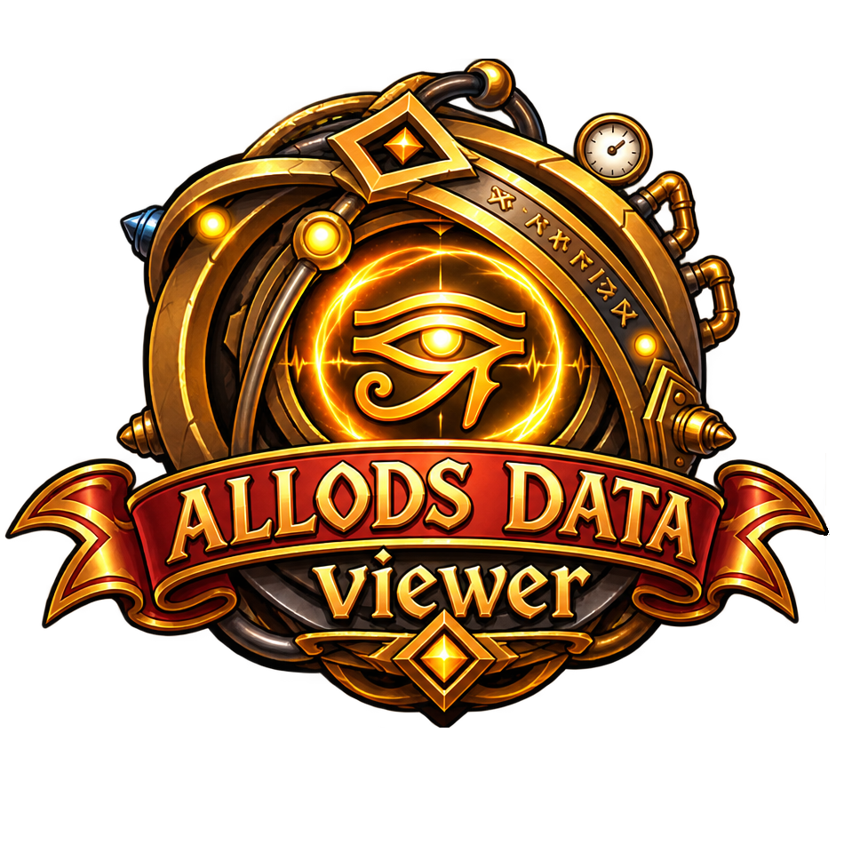

<p align="center"></p>

# Allods Data Viewer

Открытый просмотрщик, распаковщик и конвертер ресурсов клиента игры Allods Online:
архивы, локализация, текстуры, звук, видео и модели.

> Статус: **M0**, скелет проекта. План работ: [docs/ROADMAP.md](docs/ROADMAP.md).

## Цели

- Читать архивы и ресурсы игры, ничего в них не меняя.
- Консольная утилита: список файлов, поиск, распаковка.
- Текстуры в PNG, модели в glTF.
- Настольное приложение (Tauri) с деревом файлов и 3D-просмотром, тот же интерфейс работает в браузере.
- Windows и Linux.

## Устройство

| Путь | Что это |
|---|---|
| `crates/core` | библиотека на Rust с разбором форматов, без интерфейса |
| `crates/cli` | консольная утилита `adv` |
| `web/` | интерфейс на TypeScript (Vite), позже обернём в Tauri |
| `docs/` | план, архитектура, описание форматов |

## Сборка и тесты

Нужны [Rust](https://rustup.rs) (stable, 1.99 или новее) и [Node.js](https://nodejs.org) 26 или новее (LTS).
В Windows для Rust также нужны Microsoft C++ Build Tools.

```
cargo test --workspace
cargo run -p adv-cli

cd web
npm install
npm test
npm run build
```

## Правовая часть

Проект независимый и не связан с разработчиками и издателями игры. В репозитории нет
ресурсов игры и не будет, тестовые данные создаются прямо в тестах. Названия игры и
компаний принадлежат их владельцам.

Описания форматов получены из собственного анализа файлов и из проектов, перечисленных в
[docs/REFERENCES.md](docs/REFERENCES.md). Код проектов, чья лицензия это запрещает, не копируется,
правила в [CONTRIBUTING.md](CONTRIBUTING.md). «Allods Online» — товарный знак его владельцев;
название используется только чтобы указать, с какой игрой работает программа.

Лицензия [MIT](LICENSE).
